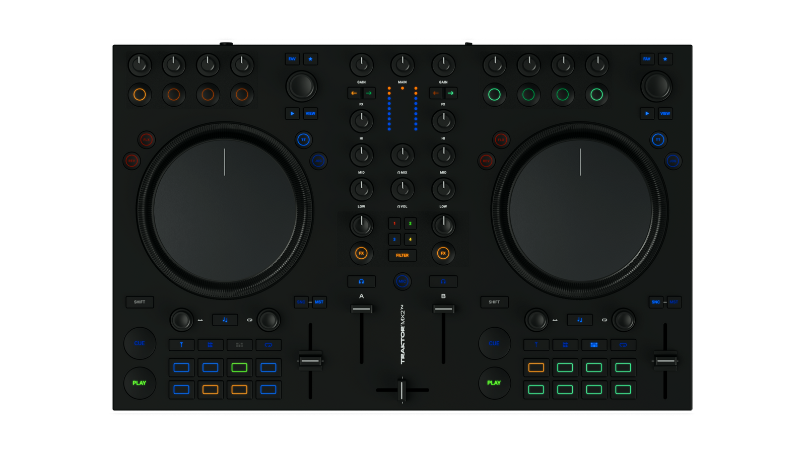

# Native Instruments MX2 Companion for Djay Pro

A Mac companion for using the Traktor MX2 with djay Pro. Choose the app for its Native and MIDI modes, or run the original MIDI bridge from Terminal. This release does not include a complete standalone djay mapping for the physical MX2.

**[Open the website](docs/index.html)** · **[Mac app](docs/downloads/MX2-Companion-0.5.0-macOS-arm64.dmg)** · **[Classic MIDI package](docs/downloads/MX2-Classic-MIDI-0.5.0.zip)**

## Install the Mac app

1. Open the DMG and drag MX2 Companion into Applications.
2. Connect the MX2, choose Native or MIDI in Companion, and start the connection.
3. Import the matching mapping in djay and select the virtual `MX2 for djay` device.

The downloadable app is for Apple silicon Macs.
This build is not notarized by Apple. If macOS blocks the first launch, follow [Apple's Open Anyway steps](https://support.apple.com/en-ie/102445) after trying to open it.

## Use Classic MIDI without the app

1. Download and unzip the [Classic MIDI package](docs/downloads/MX2-Classic-MIDI-0.5.0.zip).
2. Switch the MX2 to MIDI mode and run `DEMARRER-MX2.command`. Keep its Terminal window open.
3. Import `Traktor MX2 - Visual Complete.djayMidiMapping` in djay, select the virtual `MX2 for djay` device, and disable djay's direct `Traktor MX2` MIDI input.

The package contains the original 293-action mapping, MIDI bridge and full setup guide. This is the pre-app configuration previously checked on both decks. The mapping file alone does not provide a complete direct MX2 mapping: it needs the bridge for SHIFT, pad modes and feedback.

## Website

The English site is in `docs/`. The GitHub Actions workflow deploys it through GitHub Pages from the `main` branch after Pages is enabled in repository settings.

MX2 Companion is a community project. Traktor MX2 is a Native Instruments product, and djay is an Algoriddim product. See [notices](NOTICES.md).

## Controller overview

Left controls operate deck A; right controls operate deck B. The middle section contains the channel strips, headphone controls and channel FX selector. [Explore the interactive controller overview](https://jean-ceyrien.github.io/mx2-companion/#controller-overview).

## Mapping description

Use the matching djay mapping with Companion or the Classic MIDI bridge running. The 293 action rows include SHIFT layers and effect macros; they are not a count of physical controls. Hold only the SHIFT button on the side you are using. Pressing both SHIFT buttons together switches hardware mode.

### Playback & jogs

Transport, tempo and touch-sensitive control of each deck.

| Control | Normal action | Hold same-side SHIFT |
| --- | --- | --- |
| PLAY / CUE | PLAY starts or pauses. CUE sets or returns to the main cue, depending on playback state. | PLAY returns to the start cue and pauses. CUE jumps to the beginning. |
| Jog wheel | In TT mode, touch and turn to scratch; release to resume. Turn without scratch touch to move or nudge. | Turn to seek through the track. |
| TT / JOG | Choose touch-scratch mode or jog mode. | Same mode selection. |
| TEMPO | Change the tempo of the deck on that side. | Same tempo control. |
| SYNC / MASTER | Sync tempo and beats / make this deck the tempo master. | Toggle quantize / reset tempo. |
| KEY / FLUX | Toggle key lock / toggle slip mode. | Match key / toggle slip mode. |
| REV | Censor/reverse while held. | Toggle reverse. |

Hold only the SHIFT button on the side you are using. Pressing both SHIFT buttons together switches the MX2 hardware mode; it is not a mapped DJ action.

### Browse & load

Find a track and load it onto the deck you are working on.

| Control | Normal action | Hold same-side SHIFT |
| --- | --- | --- |
| BROWSE · turn | Move through tracks. | Move through library sources. |
| BROWSE · press | Load the selected track onto this deck. | Load without instant double. |
| FAV | Focus the library queue. | Focus library sources. |
| Star / preparation | Mark selected songs. | Unmark selected songs. |
| Preview / View | Toggle library preview / show or hide the library. | Same preview and view actions. |

### Loops & beatjump

The left encoder moves through the track. The right encoder sets the size.

| Control | Normal action | Hold same-side SHIFT |
| --- | --- | --- |
| MOVE · turn | Beatjump backward or forward. | Move an active loop without changing its length. |
| MOVE · press | Loop in/out action. | Same loop in/out action. |
| SIZE · turn | Change the autoloop length. | Change the beatjump distance used by MOVE. |
| SIZE · press | Turn autoloop on or off. | Same autoloop toggle. |

### Deck effects

Four buttons and four knobs above each jog, read from left to right.

| Control | Normal action | Hold same-side SHIFT |
| --- | --- | --- |
| FX button 1 | Invert the on/off state of each of the three FX slots. | Toggle overall deck FX. |
| FX buttons 2–4 | Toggle FX1, FX2 and FX3 respectively. | Select the next effect in the corresponding slot. |
| FX knob 1 | Set Wet/Dry for all three slots together. | Same combined Wet/Dry control. |
| FX knobs 2–4 | Adjust the parameter of FX1, FX2 and FX3 respectively. | Same parameter controls. |

The first button is a macro: it flips each slot individually, so a mixed on/off state stays mixed. Its light shows FX1 only.

### Performance pads

Each deck has eight pads and its own choice of four banks.

| Control | Normal action | Hold same-side SHIFT |
| --- | --- | --- |
| HOTCUES | Set or jump to cues 1–8. | Delete the corresponding cue. |
| STEMS | Pads 1–4 toggle mute; pads 5–8 toggle solo for the same four Neural Mix parts. | Top row toggles solo; bottom row toggles mute. |
| PATTERN | Trigger eight sampler slots for this deck. A sound must be loaded in the slot. | Stop the corresponding sample. |
| FLUX LOOP | Hold a bounce loop: 1/32, 1/16, 1/8, 1/4, 1/2, 1, 2 or 4 beats, in pad order. Release to stop. | Toggle a persistent autoloop of the same length. |

Pads run 1–4 across the top, then 5–8 across the bottom. PATTERN uses djay’s sampler, not a step sequencer. STEMS follows djay’s four-part separation layout, in channel order 4, 3, 2, 1; check the Neural Mix panel to identify the parts.

Native RGB pads use bank colors and state brightness. Individual djay hotcue colors are not copied.

### Mixer & monitoring

Channel strips stay assigned to their own decks; mixer controls do not use deck SHIFT.

| Control | Normal action | Hold same-side SHIFT |
| --- | --- | --- |
| GAIN / HIGH / MID / LOW | Adjust the owning deck’s gain and normal three-band EQ. | Same mixer action. |
| Channel faders / crossfader | Set each channel level / blend deck A and B. | Same mixer action. |
| MAIN | Set the main output level. | Same main output control. |
| Headphone buttons | Toggle preview for the corresponding deck. | Same preview selection. |
| CUE MIX / CUE VOL | Blend preview with the main mix / adjust headphone level. | Same headphone controls. |
| Channel FX assign 1 / 2 | Toggle that deck’s FX1 / FX2 slot. | Same slot toggle. |
| MIC | Toggle microphone activation in djay. Configure the audio input separately. | Same microphone toggle. |

The centre FILTER / FX1–4 selector routes the large channel knobs and round FX ON buttons: FILTER controls the filter; FX1–3 control the selected slot’s Wet/Dry and on/off state. FX4 uses instant FX4 for the button and keeps the amount knob as a filter. Turn HOLD off inside djay for hold-to-apply, release-to-stop FX4.

For audio, select MX2 channels 1–2 for the main mix and 3–4 for headphones in djay. MAIN is separate from CUE VOL. Hardware gain can change the audible level without moving djay’s on-screen gain knob.

The core integration was physically tested on the development Mac with djay Pro 5.6.9. Not every secondary gesture has been physically checked; Windows and Intel Mac builds remain unvalidated. See the [full control guide](source/distribution/docs/CONTROL-GUIDE.md) and [validation scope](source/distribution/docs/VALIDATION.md).

## License and source code

Copyright (C) 2026 Jean-Ceyrien and contributors. Original project code is licensed under **GNU GPL version 3 only (GPL-3.0-only)**, without warranty. See [LICENSE](LICENSE) and [licensing scope](LICENSING.md). Third-party components and assets retain their own terms.

**[Browse the 0.5.0 source](source/)** · **[Download the corresponding source](docs/downloads/MX2-Companion-0.5.0-source.zip)**

The source kit includes the application, Classic MIDI bridge, Swift transports, mappings, interface resources, tests and build instructions. See [source README](source/README.md). Runtime sources match the archived release; packaging and licensing were updated on 22 October 2026.
